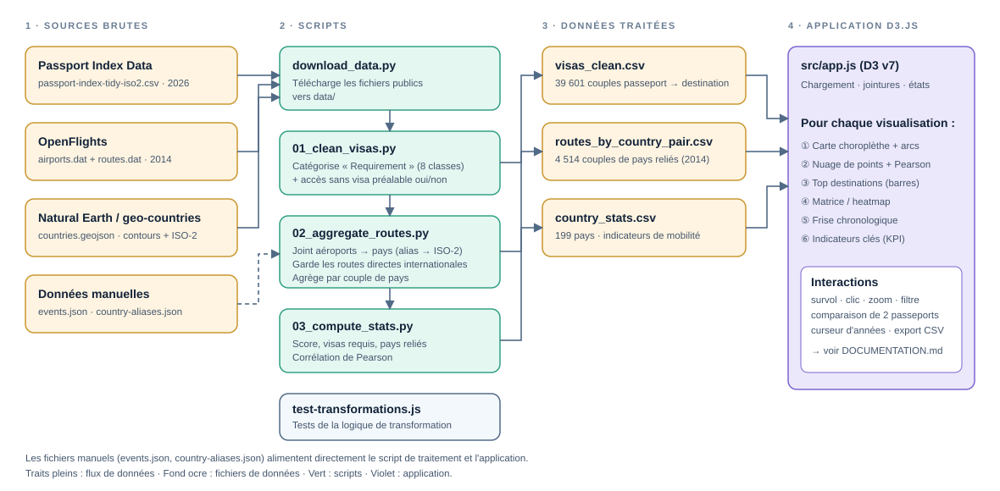
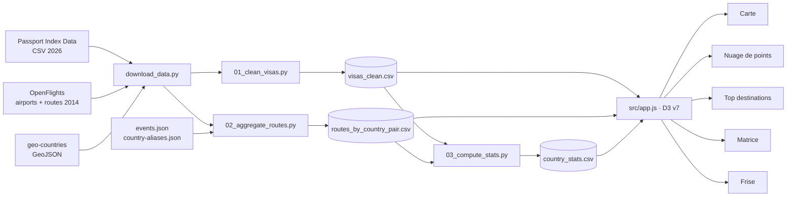
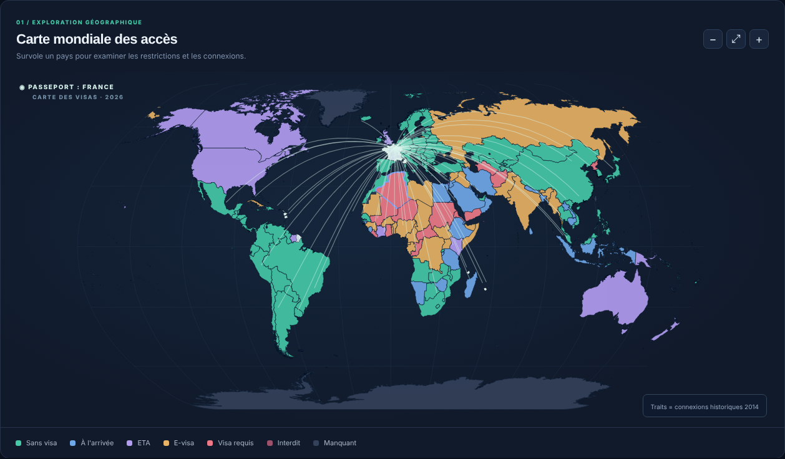
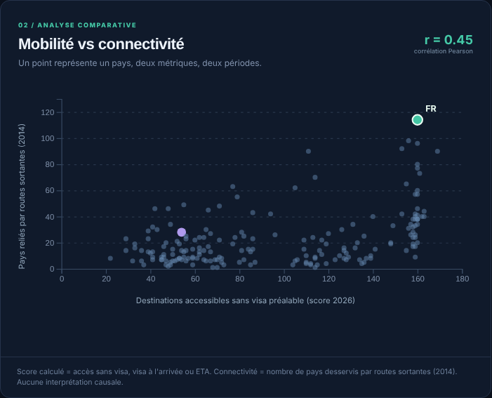
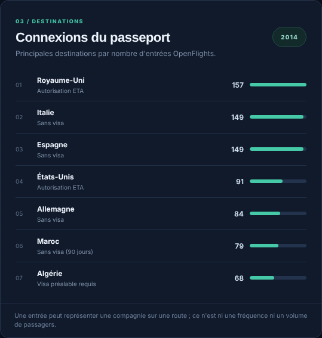
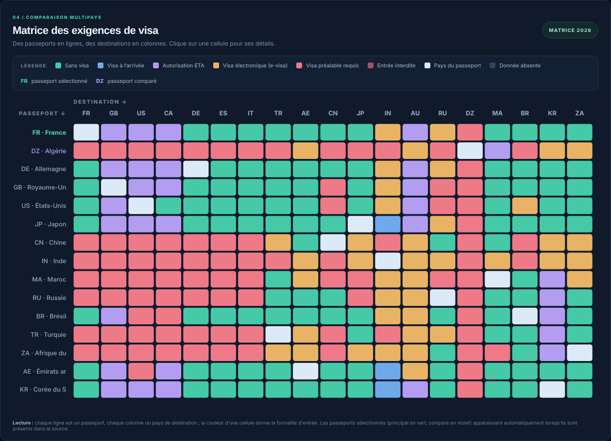
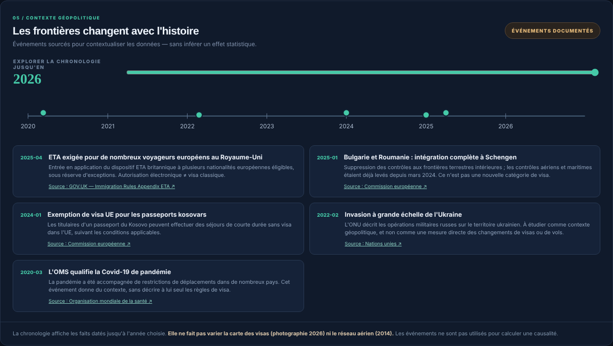

# Borderless — Documentation du projet

> Projet de visualisation d'information (D3.js) · Rendu du 20 novembre · Livraison sur Git

**Sommaire** : [1. Résumé](#1-résumé-du-projet-300-mots-max) · [2. Utilisateurs et tâches](#2-utilisateurs-visés-et-leurs-tâchesbesoins) · [3. Pipeline](#3-pipeline-de-visualisation-de-données-workflow) · [4. Fiches des visualisations](#4-fiches-des-visualisations) · [5. Données et sources](#5-données-et-pointeurs-vers-les-sources)

---

## 1. Résumé du projet (300 mots max)

Borderless est un tableau de bord interactif développé avec D3.js v7 qui explore la liberté de voyager. Il croise trois sources publiques : la matrice des exigences de visa entre passeports et destinations (Passport Index Data, 2026), les routes aériennes mondiales historiques (OpenFlights, 2014) et une chronologie d'événements géopolitiques sourcés (2020–2025).

L'utilisateur choisit un passeport et peut en comparer un second. La carte colore alors chaque pays selon la formalité d'entrée (sans visa, visa à l'arrivée, ETA, e-visa, visa requis, entrée interdite) et dessine les liaisons aériennes historiques au départ du pays. Un nuage de points confronte le score de mobilité du passeport au nombre de pays reliés, avec un coefficient de Pearson ; une liste classe les principales destinations ; une matrice compare une quinzaine de passeports sur dix-neuf destinations ; une frise contextualise les données par des événements comme la Covid-19 ou la guerre en Ukraine.

Un pipeline Python (téléchargement, nettoyage, agrégation) produit des jeux de données traités, livrés avec le projet.

Le projet assume ses limites : les sources ne sont pas contemporaines, la corrélation est descriptive et non causale, le score n'est pas le classement Henley, et les règles réelles dépendent du motif du voyage. L'objectif est de rendre visibles les écarts entre accessibilité juridique et connectivité aérienne.

*(Nombre de mots : 212.)*

---

## 2. Utilisateurs visés et leurs tâches/besoins

| Utilisateur | Besoin vis-à-vis des données | Tâches (verbes d'analyse) | Où dans l'outil |
|---|---|---|---|
| **Voyageur / étudiant mobile** (ex. titulaire d'un passeport français ou algérien) | Savoir quelles formalités d'entrée s'appliquent à son passeport et comparer avec celui d'un proche | **Rechercher** une destination · **Filtrer** par type de formalité · **Comparer** deux nationalités | Carte, matrice, filtre « Exigence à afficher », comparaison de passeports |
| **Journaliste / analyste de données** | Repérer des inégalités de mobilité et les confronter à la connectivité aérienne | **Comparer** des passeports · **Identifier** des écarts (accessibilité légale vs liaisons) · **Corréler** deux mesures | Nuage de points + r de Pearson, top destinations, export CSV |
| **Étudiant ou enseignant en géopolitique / relations internationales** | Replacer les règles d'entrée dans un contexte d'événements sourcés | **Explorer** une chronologie · **Contextualiser** un pays · **Vérifier** la source | Frise chronologique, pays surlignés sur la carte, liens vers les sources officielles |

**Principe de conception.** Aperçu d'abord (indicateurs et carte), détails à la demande (survol, clic → panneau de détail), transparence sur les limites (bandeau d'avertissement, section méthodologie).

---

## 3. Pipeline de visualisation de données (workflow)

| Étape | Fichier | Rôle |
|---|---|---|
| 1. Acquisition | `scripts/download_data.py` | Télécharge visas, aéroports, routes et contours dans `data/` |
| 2a. Nettoyage visas | `scripts/01_clean_visas.py` | Catégorise la colonne « Requirement » en 8 classes → `visas_clean.csv` |
| 2b. Routes | `scripts/02_aggregate_routes.py` | Relie aéroports et pays (ISO-2), garde les routes directes internationales, agrège par couple de pays → `routes_by_country_pair.csv` |
| 2c. Indicateurs | `scripts/03_compute_stats.py` | Calcule score de mobilité, visas requis, pays reliés et corrélation de Pearson → `country_stats.csv` |
| 3. Contrôle | `tests/test-transformations.js` | Vérifie la logique de transformation (catégories, jointures, agrégation, score) |
| 4. Visualisation | `index.html`, `src/app.js`, `src/styles.css` | Reproduit la même logique dans le navigateur, dessine les vues D3 et gère les interactions |

**Commandes** : `make data` · `make process` (lance 01 → 02 → 03) · `make test` · `make serve`. Les scripts partagent `scripts/common.py`.

---

## 4. Fiches des visualisations

Pour chaque visualisation : **mapping données → variables visuelles**, **technique et capture d'écran**, **à quoi elle sert**.

### 4.1 Carte mondiale des accès (choroplèthe + arcs de routes)

| Donnée | Type | Variable visuelle |
|---|---|---|
| Catégorie de visa du passeport sélectionné vers chaque pays | Catégorielle (8 classes) | **Couleur de remplissage** du pays |
| Pays du passeport sélectionné / comparé | Nominale | **Contour** blanc / bleu, plus épais |
| Position géographique des pays | Géographique | **Position** (projection `d3.geoNaturalEarth1`) |
| Routes aériennes sortantes (2014), 85 plus fréquentes | Relationnelle | **Arcs géodésiques** (`d3.geoInterpolate`), trait fin semi-transparent |
| Événement géopolitique actif | Nominale | **Contour pointillé ambre** sur les pays concernés |

**Technique.** Carte choroplèthe sur projection Natural Earth, superposée à un réseau d'arcs (*flow map*). Zoom et déplacement (`d3.zoom`), filtre par catégorie (les autres pays sont atténués), info-bulle au survol, panneau de détail au clic. Le choix d'une échelle **catégorielle** (couleurs distinctes) est adapté à des classes sans ordre numérique ; les arcs en blanc discret évitent de concurrencer la couleur des pays.

**À quoi ça sert.** Obtenir en un coup d'œil la géographie de l'accès d'un passeport, trouver une destination et voir si elle est desservie par des liaisons historiques.

**Limites.** Au plus 85 arcs affichés ; les pays absents de la matrice restent en gris ; données de visa à vérifier auprès des autorités.

### 4.2 Nuage de points « Mobilité vs connectivité »

| Donnée | Type | Variable visuelle |
|---|---|---|
| Score de mobilité 2026 (destinations sans visa préalable) | Quantitative | **Position X** |
| Nombre de pays reliés en direct (2014) | Quantitative | **Position Y** |
| Passeport sélectionné / comparé / autres | Nominale | **Couleur et taille** du point (vert, grand / violet / gris, petit) |
| Corrélation de Pearson | Statistique | **Texte** « r = … » en en-tête |

**Technique.** Diagramme de dispersion (`d3.scaleLinear`, axes, grille discrète), un point par pays (pays avec plus de 150 enregistrements de visa et au moins une liaison). Clic sur un point = changer de passeport. Le r de Pearson est recalculé à partir des mêmes données que celles affichées.

**À quoi ça sert.** Repérer des tendances et des cas atypiques (pays très mobiles mais peu reliés, ou l'inverse). Attention : association **descriptive** entre deux périodes différentes (2026 et 2014), pas de causalité.

**Limites.** Deux périodes différentes (visas 2026, routes 2014) ; corrélation descriptive (r = 0,45 sur 190 pays), aucune causalité ; le score n'est pas le classement Henley.

### 4.3 Top destinations (barres)

| Donnée | Type | Variable visuelle |
|---|---|---|
| Nombre d'entrées de routes OpenFlights par pays de destination | Quantitative | **Longueur de la barre** + valeur en texte |
| Rang | Ordinale | **Position verticale** (liste triée) |
| Formalité de visa pour la destination | Catégorielle | **Texte secondaire** sous le nom |

**Technique.** Liste classée avec barres horizontales proportionnelles au maximum, filtrable par catégorie de visa. Clic = ouverture du panneau de détail.

**À quoi ça sert.** Passer de la vue d'ensemble au détail : quelles sont les destinations les mieux connectées, et quelle formalité s'y applique.

**Limites.** Une entrée OpenFlights = une compagnie sur une route : ce n'est ni une fréquence de vols ni un trafic de passagers ; réseau de 2014.

### 4.4 Matrice des exigences de visa (heatmap)

| Donnée | Type | Variable visuelle |
|---|---|---|
| Passeport (une quinzaine) | Nominale | **Ligne** (position Y, `d3.scaleBand`) |
| Pays de destination (19) | Nominale | **Colonne** (position X) |
| Catégorie de visa du couple passeport → destination | Catégorielle | **Couleur** de la cellule (cf. légende) |
| Passeport sélectionné / comparé | Nominale | **Couleur et graisse** de l'étiquette de ligne |
| Diagonale (même pays) | Nominale | Couleur « Pays du passeport » |

**Technique.** Matrice de cellules colorées (*heatmap* catégorielle) avec **légende** des huit classes, titres d'axes et note de lecture. Info-bulle au survol ; un clic sélectionne le passeport de la ligne et ouvre le détail de la destination.

**À quoi ça sert.** Comparer d'un coup plusieurs passeports sur les mêmes destinations et repérer les asymétries (ex. A peut entrer sans visa chez B alors que l'inverse est faux).

**Limites.** Seulement une quinzaine de passeports et 19 destinations affichés ; les règles réelles dépendent du motif et de la durée du séjour.

### 4.5 Chronologie géopolitique (frise + cartes d'événements)

| Donnée | Type | Variable visuelle |
|---|---|---|
| Date de l'événement (2020–2025) | Temporelle | **Position X** sur l'axe `d3.scaleUtc` |
| Événement sélectionné | Nominale | **Taille et couleur** du point (ambre, grand) |
| Pays concernés | Nominale | **Contour pointillé** sur la carte |
| Source officielle | Texte | **Lien** sur chaque carte |

**Technique.** Frise temporelle interactive avec curseur d'années ; le curseur ne filtre que l'**affichage des annotations**, pas les données quantitatives (les visas ne sont pas recalculés par année).

**À quoi ça sert.** Contextualiser les données avec des événements sourcés (OMS, ONU, Commission européenne, GOV.UK) sans prétendre mesurer un effet.

**Limites.** Le curseur ne filtre que les annotations ; aucun lien de cause à effet entre un événement et les visas n'est établi.

### 4.6 Indicateurs clés (KPI)

| Donnée | Variable visuelle |
|---|---|
| Destinations sans visa préalable (sans visa + arrivée + ETA) | Grand nombre, accent vert |
| Visas à demander (`visa required`) | Grand nombre, accent rose |
| Pays reliés en direct (2014) | Grand nombre, accent bleu |
| Lignes enregistrées OpenFlights | Grand nombre, accent ambre |

**À quoi ça sert.** Résumer le passeport sélectionné en quatre chiffres lisibles avant l'exploration détaillée.

*Vue d'ensemble de l'application : voir `img/00_vue_generale.png`.*

**Limites.** Le score regroupe sans visa, visa à l'arrivée et ETA : ce n'est pas « strictement sans formalité ».

---

## 5. Données et pointeurs vers les sources

| Source | Lien | Période | Fichiers traités |
|---|---|---|---|
| Passport Index Data (imorte) | https://github.com/imorte/passport-index-data | Février 2026 | `data/processed/visas_clean.csv`, `country_stats.csv` |
| OpenFlights (airports, routes) | https://openflights.org/data.php | Juin 2014 | `data/processed/routes_by_country_pair.csv`, `country_stats.csv` |
| geo-countries / Natural Earth | https://github.com/datasets/geo-countries | — | Contours chargés par l'application |
| Événements géopolitiques | OMS, ONU, Commission européenne, GOV.UK | 2020–2025 | `data/events.json` (liens individuels) |

> **Kaggle.** Cette version n'utilise **aucun jeu de données Kaggle** : le score de mobilité est calculé à partir de la matrice bilatérale de Passport Index Data et n'est pas le classement officiel Henley. Un import du Henley Passport Index (ou d'un jeu Kaggle équivalent) est prévu en sprint 2 (cf. README).

Le dictionnaire des colonnes des fichiers traités est dans [`data/DATA.md`](../data/DATA.md).
